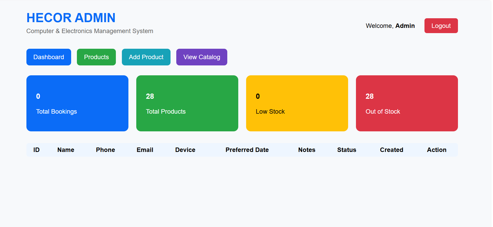
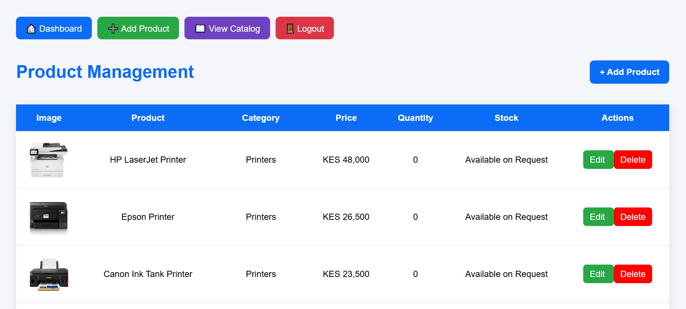

# 🖥️ HECOR Computers & Electronics Management System

A web-based electronics repair booking and product catalog management system developed using **PHP, MySQL, HTML5, CSS3, and JavaScript**.

The system is designed to help electronics businesses manage customer repair requests, monitor repair progress, organize products, and provide convenient online product browsing.

## 📌 Project Overview

HECOR Computers & Electronics Management System combines electronics repair service management with an online product catalog.

Customers can request repair services and browse available computer accessories, printer supplies, storage devices, networking equipment, and electronics.

Administrators can manage repair bookings, monitor service progress, and maintain product information through dedicated management interfaces.

This project demonstrates practical full-stack web development, database integration, administrative workflows, and customer-facing web functionality.

## ✨ Key Features
## 📸 System Screenshots

### Homepage


### Product Catalog


### Repair Booking


### Admin Dashboard


### Product Management

### 🔧 Repair Booking System

- Online electronics repair booking.
- Customer repair request submission.
- Repair service management.
- Repair progress monitoring.
- Administrative management of repair requests.

### 🛠️ Administration Dashboard

- Dedicated administrator login.
- View and manage repair bookings.
- Monitor repair service operations.
- Access product management features.
- Manage product catalog information.

### 🛒 Product Catalog

- Browse computer accessories and electronics.
- Search for products.
- Filter products by category.
- View product images and descriptions.
- Display prices in Kenyan shillings (KES).
- Check product availability information.
- Order products through WhatsApp.

### 📦 Product Management

- Add new products.
- Edit existing products.
- Update product prices.
- Delete products.
- Organize products by category.
- Manage product images and descriptions.

### 🖨️ Product Categories

The catalog supports the following categories:

1. Printer Supplies
2. Computer Accessories
3. Storage Devices
4. Networking Equipment
5. Power Accessories
6. Printers

### 💬 WhatsApp Ordering

Customers can select a product and use its WhatsApp ordering link to contact the business.

This provides a convenient way for customers to make product inquiries without requiring an online payment system.

## 🛠️ Technologies Used

| Technology | Purpose |
|---|---|
| PHP | Backend development |
| MySQL | Database management |
| HTML5 | Website structure |
| CSS3 | Interface styling |
| JavaScript | Client-side functionality |
| MySQLi | Database connectivity |
| XAMPP | Local development |
| Git & GitHub | Version control |

## 📂 Project Structure

```text
hecor/
│
├── css/
│   ├── catalog.css
│   └── style.css
│
├── js/
│   └── catalog.js
│
├── images/
│   ├── hero.jpg
│   └── products/
│
├── index.php
├── index.html
├── catalog.php
├── book_repair.php
├── admin_login.php
├── admin_dashboard.php
├── admin_nav.php
├── admin_products.php
├── add_product.php
├── edit_product.php
├── delete_product.php
├── email_notification.php
├── config.php
├── logout.php
├── README.md
└── .gitignore
```

*Some files may vary depending on the current project version.*

## ⚙️ Installation and Setup

### Requirements

- XAMPP or another PHP/MySQL server
- PHP
- MySQL or MariaDB
- Web browser

### Step 1: Clone the Repository

```bash
git clone https://github.com/Mogainy/hecor-electronics.git
```

### Step 2: Move the Project

Place the downloaded project in your XAMPP `htdocs` directory.

Example:

```text
C:\xampp\htdocs\hecor
```

### Step 3: Configure the Database

1. Start Apache and MySQL in XAMPP.
2. Open `http://localhost/phpmyadmin`.
3. Create a database named `hecor_db`.
4. Import a sanitized SQL database backup, if supplied with the repository.
5. Configure the local database connection according to your environment.

### Step 4: Configure Email Notifications

If email notifications are enabled, configure the required SMTP settings using your own credentials.

Never commit real passwords, SMTP app passwords, or other secrets to a public GitHub repository.

### Step 5: Run the Application

Open:

```text
http://localhost/hecor/
```

To access the product catalog:

```text
http://localhost/hecor/catalog.php
```

Administrator access requires an account configured for the application.

## 🔄 System Workflow

**1. Repair Booking**

A customer submits an electronics repair request through the website.

**2. Repair Management**

An administrator reviews the request and manages its progress.

**3. Product Browsing**

Customers browse available products, compare prices, and view product information.

**4. Product Ordering**

Customers use the WhatsApp ordering option to contact the business about a selected product.

**5. Catalog Administration**

Administrators add products, edit details, and update prices and availability.

## 📸 Screenshots

Screenshots can be added to demonstrate the application's interface:

- Homepage
- Repair booking form
- Administrator dashboard
- Repair management interface
- Product catalog
- Product management dashboard

## 🎯 Project Objectives

- Digitize electronics repair booking.
- Improve organization of repair service requests.
- Simplify electronics product management.
- Provide customers with an accessible online catalog.
- Support customer inquiries through WhatsApp.
- Demonstrate practical PHP and MySQL development skills.

## 🚀 Future Enhancements

- Online payment integration.
- Customer accounts and repair history.
- Automated repair status notifications.
- Inventory alerts.
- Sales analytics.
- Invoice generation.
- Advanced repair tracking.
- Mobile application support.

## 👨‍💻 Developer

**Enock Mokaya**

Diploma in Information Technology  
Zetech University, Kenya

**GitHub:** https://github.com/Mogainy

**Email:** enockmokaya35@gmail.com

## 📄 Project Status

Portfolio project demonstrating PHP and MySQL development, electronics repair service workflows, database-driven product catalogs, and administrative management functionality.

---

Developed by Enock Mokaya.